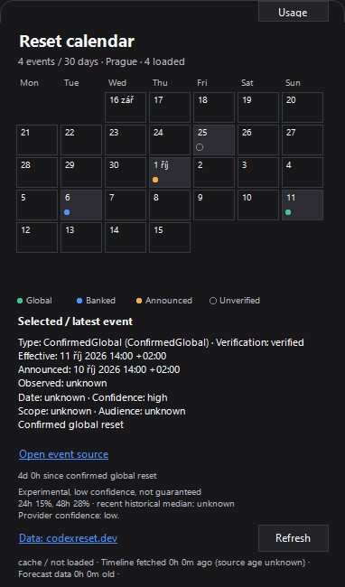

# Codex Usage — Reset Calendar (Windows)

Private extension maintained by CZPavel, based on [Victor Zakharov's Codex Usage](https://github.com/VictorZakharov/codex-usage), upstream v0.2.7 / `75cf1eaad84c5794fdf733157bd443f8d1103800`. Original MIT license, copyright and authorship are retained in LICENSE and the upstream Git history.



## Changes in this fork

- Compact **Reset Calendar** switch and tray menu, showing the last 30 calendar dates in **Europe/Prague**, including DST. Global, banked, announced and uncertain events have distinct markers and details.
- Announcement timestamps remain distinct from effective timestamps. Missing scope, eligible plans and exact effective times remain unknown. A banked grant never advances the global-reset clock. Conflicting verification fields are treated conservatively.
- Forecast section is clearly unofficial and not guaranteed. Current provider has no valid forecast: `Není dostatek dat`. No local predictive model or assumed probability units.
- Historical backfill immediately at startup, then refresh every 15 minutes. Fallback history, status, latest preserves the local archive. The calendar shows record counts, source and partial coverage; unverified global/banked events use colored outlines.
- Optional **Reset notifications** in the tray menu (off by default), with stable-ID deduplication stored across restarts. First retrieval establishes a silent baseline.
- Codex credentials are **read only**: HTTP 401/403 asks you to renew login in Codex. This fork never refreshes or saves Codex credentials.
- One tray instance across fork copies and the original installation. Reopening the fork activates its existing popup. If the original version is already running, quit it first. Original installation and startup settings are preserved; fork data remains separate.

### External data and privacy

Data: [codexreset.dev](https://codexreset.dev/), using public read-only GET `/api/history?lang=en` and `/api/forecast?lang=en`, no API key. [API documentation](https://codexreset.dev/api/). The calendar includes linked attribution and the HTTP reader identifies this project. Refreshes respect a one-request-per-minute maximum and Retry-After. Requests carry no Codex tokens, account identifiers or usage data. This community source is independent of OpenAI; its records do not prove a reset of your personal account.

The originally requested primary provider `codex-reset.com` was inspected and integrated, but AVG (Avast engine) blocked its forecast URL and quarantined the associated installed build with `URL:Phishing`. The runtime source was therefore replaced with the available alternative explicitly listed in the task. No antivirus exception, quarantine restore or protection change was made. The current runtime does not contact the blocked provider. Its old parser is retained only for offline regression fixtures, and its cache is not reused.

The alternative currently supplies partial history, mostly `recorded` community archives without independent verification. These remain **Uncertain**, including archived banked announcements; their original event type, scope, source and provenance remain inspectable. Announcement/observation times are not actual reset times. Date-only evidence stays date-only. Current forecast values are null, so the UI correctly shows **Není dostatek dat**. No local probability model is substituted. Undocumented numeric probability units are not guessed. Confirmed notifications require explicit verified official evidence; unknown entries never notify. See [VALIDATION.md](VALIDATION.md).

### Local installation and update

Requires Windows 10/11. Build requires .NET 10 SDK; the self-contained x64 executable requires no installed .NET runtime.

```powershell
dotnet restore CodexUsage.sln
dotnet format CodexUsage.sln --verify-no-changes --no-restore
dotnet build CodexUsage.sln -c Release --no-restore
dotnet run --project tests/CodexUsage.Tests -c Release --no-build
.\scripts\build.ps1 -Architecture x64
.\scripts\install.ps1 -SkipBuild
```

This fork installs under `%LOCALAPPDATA%\Programs\CodexUsageNotif` and creates **Codex Usage Reset Calendar** in the Start Menu and on the desktop. Launching the shortcut opens the current popup instead of creating another tray icon. Exit the fork before updating its executable. Do not use an upstream installer to update this fork. Automatic startup is changed only when you explicitly enable it in this fork's UI; it uses `CodexUsageNotif`, leaving the original `CodexUsage` entry intact.

Runtime files are local to `%LOCALAPPDATA%\CodexUsageNotif` and must never be committed. Existing settings and history were copied once from the original data directory for this workstation's first installation. The original files are not modified. New usage history continues independently.

### Technical notes

See the [public API and fallback assessment](docs/reset-api.md). `--render-calendar-cache output.png` renders the actual public reset cache for offline UI diagnostics. The opt-in test flag `--live-resets` verifies initial historical backfill into a fresh temporary cache without reading Codex credentials.

The original WinForms architecture and theme palette are retained. `Core/Resets` owns schema interpretation, UTC instants, Prague date selection, last-good caching and persisted notification IDs. `ResetCalendarControl` only presents data; `TrayApplicationContext` owns timers, asynchronous refresh and Windows tray balloons. Reset-service HTTP is isolated from the credential-bearing usage client. Tests use synthetic data and injected HTTP handlers. Preview images use synthetic events.

---

# Upstream application documentation

A small, native Windows tray app for one job: keeping your OpenAI Codex usage visible.

It is intentionally Codex-only. There are no provider plugins, browser-cookie imports, API-key forms, or unrelated dashboards.

## Features

- Supersampled, anti-aliased system-tray meter with an original six-lobed contour showing the least available Codex quota window; a fresh window is `100` and fully filled.
- Compact popup with available percentages for the 5-hour and weekly windows, reset countdowns, plan, and credits when available.
- Persistent 24-hour, 7-day, 30-day, and 90-day history charts, with per-point hover details, reset markers, and a usage forecast that projects to zero or the next reset, opened from the tray's right-click menu. Forecasts that exhaust quota early include their lead time; safer forecasts show the expected quota remaining at reset.
- Activity-aware forecasts learn the local hours when quota has historically decreased and exclude observed off hours from the pace. The checkbox switches between flat off-hour segments on a uniform time axis and an active-time view that collapses those intervals. A gap bounded by equal quota readings is treated as assumed flat time (including overnight); otherwise, the forecast falls back to elapsed time until all 24 clock hours have evidence.
- Local Codex token totals for the selected chart period, the current primary quota window since reset, and today. They load in the background with a progress indicator; the reader parses only token counter events in local Codex session files, never conversation messages.
- Support for model-specific Codex limits returned by the service.
- Manual refresh plus configurable 1, 2, 5, 15, or 30 minute polling.
- Optional Windows notifications when available quota drops to 30%, 20%, 10%, or 0%.
- System, dark, and light themes.
- Optional per-user launch at sign-in; no administrator access required.
- Single-instance behavior with self-contained and smaller .NET-dependent single-file builds.

## Screenshots

### Tray popup


### Usage history


## How authentication works

Codex Usage reuses the ChatGPT sign-in already stored by Codex in `%USERPROFILE%\.codex\auth.json` (or `$env:CODEX_HOME\auth.json`). It never asks for or stores a password, API key, cookie, or copied token.

This fork never refreshes or writes credentials. If authorization expires, renew the sign-in in Codex, then refresh here. Usage credentials are sent only to the existing `chatgpt.com` usage endpoint; public reset requests use a separate client without authorization.

Use ChatGPT authentication rather than API-key authentication. OpenAI documents the supported Codex sign-in methods and the `codex login` flow in its [authentication guide](https://learn.chatgpt.com/docs/auth).

## Build and run

Prerequisites: Windows 10/11 and the .NET 10 SDK.

```powershell
dotnet run --project .\src\CodexUsage.App\CodexUsage.App.csproj
```

To create a self-contained executable that does not require .NET on the destination computer, run or double-click `build.bat`:

```batch
build.bat
artifacts\win-x64\CodexUsage.exe
```

For a much smaller single-file executable, use `build-small.bat` instead:

```batch
build-small.bat
artifacts\win-x64-framework-dependent\CodexUsage.exe
```

The smaller build requires the x64 .NET 10 Desktop Runtime on the destination computer. Both builds also write `CodexUsage.exe.sha256` beside the executable.

For Windows on ARM:

```batch
build.bat -Architecture arm64
build-small.bat -Architecture arm64
```

The equivalent PowerShell commands are `.\scripts\build.ps1` and `.\scripts\build.ps1 -FrameworkDependent`.

To install it for the current user and create a Start Menu shortcut:

```powershell
.\scripts\install.ps1
```

The install script copies the app to `%LOCALAPPDATA%\Programs\CodexUsageNotif`. Enable launch at sign-in from the tray menu or Settings.

"Start with Windows" applies at the next full Windows sign-in or reboot; locking and unlocking the current session does not rerun startup apps. Windows may also delay `Run`-key applications briefly after sign-in.

## Test

The tests use no third-party packages:

```powershell
dotnet run --project .\tests\CodexUsage.Tests\CodexUsage.Tests.csproj
```

An opt-in live check reads the local Codex login, calls OpenAI once, and prints only the plan and quota percentages:

```powershell
dotnet run --project .\tests\CodexUsage.Tests\CodexUsage.Tests.csproj -- --live
```

## Privacy and limitations

- Settings are stored in `%LOCALAPPDATA%\CodexUsageNotif\settings.json`; no secrets are stored there.
- Usage history is stored locally in `%LOCALAPPDATA%\CodexUsageNotif\history.jsonl`. Flat duplicate readings are compressed, and history is limited to 90 days and 50,000 samples.
- Token totals are best-effort sums of the counters emitted in local `%CODEX_HOME%\sessions` and `archived_sessions` files. They include model-processing tokens such as cached context and non-visible output, so they do not map one-to-one to quota percentage and may be unavailable when local session counters are absent.
- This is an independent, unofficial utility and is not affiliated with or endorsed by OpenAI.
- Local release builds are unsigned, so Windows SmartScreen may show an unrecognized-app warning. Verify the adjacent SHA-256 file before running a distributed copy.
- The tray app follows the behavior of CodexBar's OAuth usage source. The underlying ChatGPT usage route is not a public, versioned API and may change; parser and endpoint updates may occasionally be necessary.
- If only API-key authentication is configured, the app asks you to sign in with ChatGPT because ChatGPT plan quotas are separate from API billing limits.

## Inspiration

Inspired by [CodexBar](https://github.com/steipete/CodexBar), which is MIT-licensed. This implementation is Windows-native and limited to Codex.
